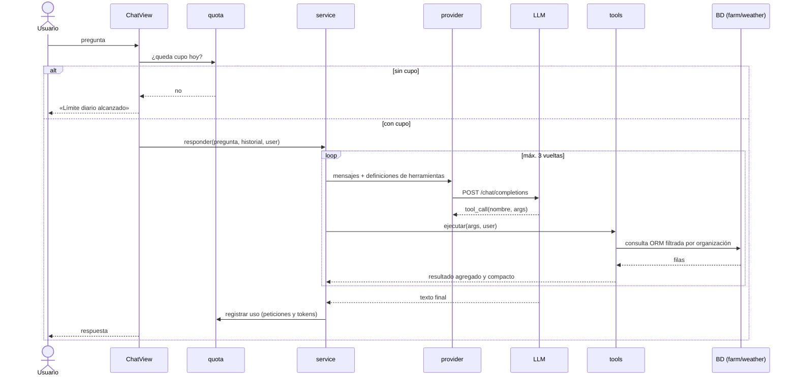
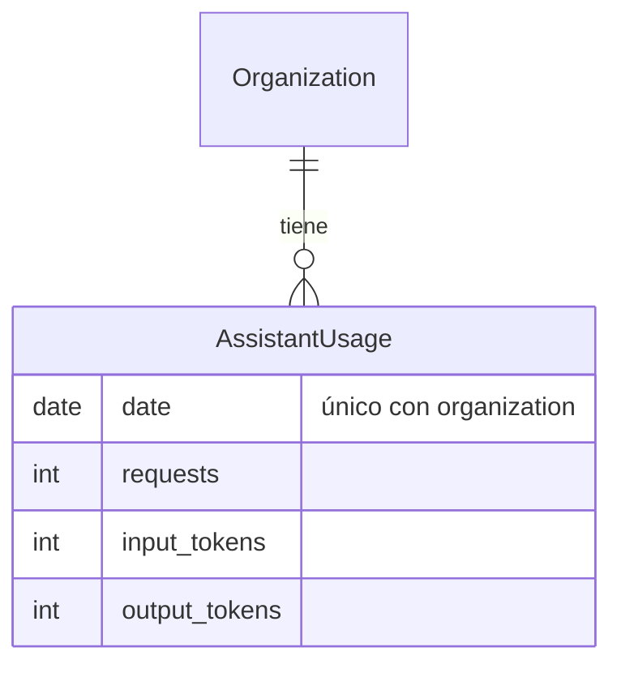
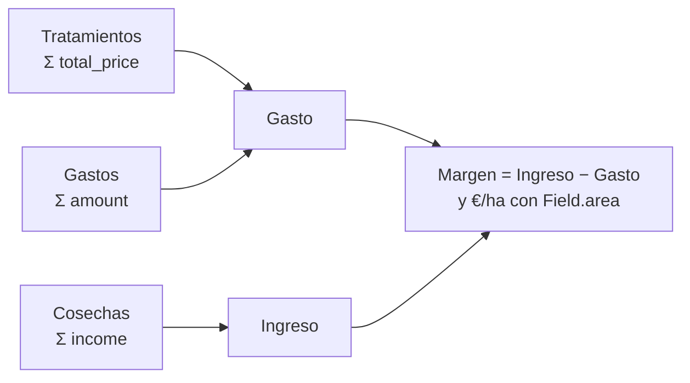

# Asistente IA (`assistant`)

> **Estado:** diseño. Todavía no hay código. Este documento fija la arquitectura, los casos de uso y los límites antes de implementar.

Asistente de **solo lectura** que responde en lenguaje natural sobre los datos de la organización: tratamientos, costes, productos, tiempo y cálculo de compras.

---

## 1. Decisiones clave

| Decisión | Por qué |
|---|---|
| **App propia `assistant`** | Cumple los criterios de cuándo crear una app: depende de un servicio externo con cuotas, se puede quitar sin romper nada y solo depende de `farm`, `weather` y `core`, sin ciclos. Sustituye la decisión anterior de dejarlo en `farm`. |
| **Tool calling** | El modelo pide los datos que necesita mediante funciones nuestras. Se descartan el **volcado de contexto** (es lo que encareció el módulo anterior), **RAG** (sirve para texto libre y aquí los datos son tablas) y **text-to-SQL** (con varias organizaciones, un fallo filtraría datos de otra). |
| **Los cálculos los hace Python, no el modelo** | Las dosis, totales y costes salen del mismo código que usa la app. El modelo solo interpreta la pregunta y redacta la respuesta, así que no se inventa números. |
| **Un único cliente compatible con OpenAI** | Gemini, Groq, OpenRouter y Cloudflare Workers AI aceptan el formato `chat/completions` con herramientas. Cambiar de proveedor es cambiar tres variables de entorno. Se implementa con `urllib`, igual que `weather/aemet/client.py`, así que no añade dependencias. |
| **Solo lectura** | Para crear o editar ya existen los formularios. Así evitamos confirmaciones y acciones peligrosas, y las herramientas son más pequeñas. Se puede ampliar más adelante. |
| **Historial en la sesión de Django, no en BD** | No hay ningún requisito de guardar conversaciones (el antiguo `ChatMessage` se borró). Se guardan solo los últimos 4 turnos. |

---

## 2. Arquitectura

### Componentes


**Dependencias:** `assistant → farm, weather, core`. Ninguna app depende de `assistant`.

### Estructura de carpetas

```
assistant/
  apps.py
  urls.py · views.py      # ChatView (POST pregunta → respuesta), con FeatureFlagMixin
  service.py              # bucle: modelo ↔ herramientas (máx. 3 vueltas)
  providers.py            # cliente HTTP compatible con OpenAI (urllib)
  quota.py                # cupo diario por organización
  prompts.py              # prompt de sistema
  models.py               # AssistantUsage
  tools/
    __init__.py           # registro: nombre → (esquema JSON, función)
    resolve.py            # «vegueta» → Field, «cobre» → Product
    treatments.py · costs.py · products.py · purchase.py · weather.py
  tests/
templates/assistant/chat.html   # convención del proyecto: plantillas globales
```

### Flujo de una pregunta



### Modelo de datos



---

## 3. Herramientas

Reglas comunes:

- **La organización nunca la decide el modelo.** Cada función recibe `user` desde la vista y filtra con `ownership_objects.get_queryset_for_user(user)`, el mismo mecanismo que `get_shopping_list`.
- **Se usan nombres en vez de IDs.** El modelo pasa «vegueta» y `resolve.py` lo busca sin distinguir mayúsculas ni tildes. Si hay 0 coincidencias o más de una, la herramienta devuelve los candidatos y el modelo pregunta al usuario. Así no hace falta una herramienta de «listar» ni una vuelta extra.
- **Fechas en formato ISO.** El prompt incluye la fecha de hoy. Si no se indica periodo, se usa el año natural en curso, y cada herramienta pasa siempre las fechas de forma explícita (por ejemplo, `get_cost_by_product_type` aplica por defecto los últimos 365 días).
- **Salida compacta:** texto tabular con solo los campos necesarios, un máximo de 20 filas y «… y N más».

| Herramienta | Parámetros | Reutiliza | Devuelve |
|---|---|---|---|
| `historial_tratamientos` | `parcelas?`, `producto?`, `estado?`, `desde?`, `hasta?`, `limite=10` | `Treatment`, `TreatmentProduct` | fecha, parcela, nombre, estado y productos con su dosis |
| `costes` | `parcelas?`, `desde?`, `hasta?`, `agrupar_por` (`parcela` · `tipo_producto` · `tipo_gasto`), `incluir_ingresos=false` | `TreatmentProduct.total_price`, `Expense.amount`, `Harvest.income` | € totales, €/ha y, con ingresos, el margen |
| `producto` | `nombre`, `desde?`, `hasta?` | `TreatmentProduct`, `ProductPriceHistory` | consumo total, nº de tratamientos, precio actual y cambios de precio |
| `calcular_compra` | `productos[]`, `parcelas[]`, `mojado_l_ha?`, `tipo=pulverizacion`, `dosis?` | fórmula de dosis de `farm` (ver §4.5) | por producto: dosis, cantidad total y coste; superficie y caldo totales |
| `ventana_tratamiento` | `parcelas?`, `dias=3` | `weather.services.get_weather_summary`, `treatment_rules.treatment_level` | por municipio y día: `ok` / `warn` / `bad`, % de lluvia y viento |

Si el flag `WEATHER` está apagado, `ventana_tratamiento` no se registra y el modelo no la ve.

---

## 4. Casos de uso y cómo se resuelven

### 4.1 Historial de tratamientos

- *«¿Cuándo tratamos por última vez la vegueta?»* → `historial_tratamientos(parcelas=["vegueta"], estado="completed", limite=1)`
- *«¿Qué productos hemos echado este mes?»* → `historial_tratamientos(desde="2026-11-01")`

El modelo traduce la pregunta a filtros y redacta la respuesta con las filas devueltas. Si la parcela no existe o es ambigua, la herramienta devuelve candidatos y el modelo pregunta cuál.

### 4.2 Costes y rentabilidad

- *«¿Cuánto llevamos gastado este año en injertos?»* → `costes(parcelas=["injertos"], desde="2026-01-01")`
- *«¿En qué se nos va el dinero?»* → `costes(agrupar_por="tipo_producto")`
- *«¿Qué parcela es más rentable?»* → `costes(agrupar_por="parcela", incluir_ingresos=true)`



**Caso límite:** las cosechas sin precio de venta no tienen ingreso. Se cuentan aparte («2 cosechas sin precio») para que el modelo lo diga y no dé un margen engañoso.

### 4.3 Productos y compras

- *«¿Cuánto cobre hemos gastado esta campaña?»* → `producto(nombre="cobre", desde=…)`
- *«¿Ha subido el precio del X?»* → `producto(nombre="X")` (usa `ProductPriceHistory`)

### 4.4 Tiempo y ventana de tratamiento

- *«¿Puedo tratar mañana la vegueta?»* → `ventana_tratamiento(parcelas=["vegueta"], dias=2)`

Los umbrales **no los decide el modelo**: son los de `weather/treatment_rules.py` (`ok` si la lluvia es < 20 % y el viento ≤ 20 km/h), los mismos que muestra la pantalla de Tiempo. La caché y los errores de AEMET los gestiona `get_weather_summary`; la herramienta devuelve sus `errors` (parcela sin ubicación, AEMET caído) para que el modelo los explique.

### 4.5 Cálculo de compra para un tratamiento

> *«Dime cuánto X tengo que comprar para tratar vegueta + injertos a 1500 L/ha»* (X puede ser uno o varios productos)


**Cálculo** (dosis estándar del producto, `Product.spraying_dose` / `spraying_dose_type`):

| Tipo de dosis | Cantidad total |
|---|---|
| L/1000L, kg/1000L | dosis × mojado × ha / 1000 |
| % | dosis / 100 × mojado × ha |
| L/ha, kg/ha | dosis × ha (el mojado no influye) |

*Ejemplo:* vegueta 2 ha + injertos 1,5 ha = 3,5 ha → 5.250 L de caldo. Con X a 0,5 L/1000L salen 2,63 L, y el coste es la cantidad × `Product.price`.

**Casos límite:**

- **No resta existencias:** AgroGest no lleva inventario, así que «comprar» significa «cantidad necesaria». La respuesta lo indica.
- **Producto sin dosis de pulverización:** se informa y el modelo pide la dosis, que se pasa en el parámetro `dosis`.
- **Falta el mojado y la dosis depende del caldo:** la herramienta lo pide. No se asume `REFERENCE_WATER_PER_HA` (1000 L/ha) porque cambiaría la cantidad a comprar sin que el usuario lo sepa. Con dosis por hectárea no hace falta.
- **No se redondea a envases**, porque no tenemos el formato de venta.

**Prerrequisito:** la fórmula está repetida en `TreatmentProduct.calculate_total_dose`, `Product.cost_per_ha` y `Treatment.calculate_product_for_partial_load`. Se extrae a una función pura en `farm` (por ejemplo `farm/dosing.py → total_amount(dose, dose_type, area_ha, water_per_ha)`) que usan esos tres sitios y la herramienta. Así el asistente da **exactamente** las mismas cifras que la app.

### 4.6 Fuera de alcance

Si ninguna herramienta cubre la pregunta (por ejemplo, consejos agronómicos o crear un tratamiento), el prompt obliga a decir que no puede responderla en vez de inventar.

---

## 5. Ahorro de tokens

| Técnica | Efecto |
|---|---|
| Tool calling | Solo viajan los datos pedidos, nunca la organización entera. |
| 5 herramientas con descripciones cortas | Las definiciones se envían en **cada** llamada; menos herramientas son menos tokens fijos. |
| Resolución de nombres en el servidor | Ahorra una vuelta de «listar parcelas/productos». |
| Resultados agregados en texto tabular | Mucho más corto que JSON con claves repetidas. Máximo 20 filas. |
| Historial de 4 turnos, sin resultados de herramientas antiguos | El coste no crece con la conversación. |
| `max_tokens` = 500 y máximo 3 vueltas | Acota el peor caso. |
| Prompt de sistema < 300 palabras | Coste fijo bajo. |

Estimación orientativa: **1.500–3.000 tokens por pregunta**. No hacen falta formatos de serialización especiales: los datos son pocos (unas 6 parcelas) y lo que encarece es enviar de más, no el formato.

---

## 6. Garantía de coste cero

1. **Clave de un proyecto sin facturación.** Si no hay tarjeta asociada, el proveedor no puede cobrar: al agotar la cuota responde `429`. Esta es la garantía real.
2. **Cupo propio** (`AssistantUsage`): `ASSISTANT_DAILY_LIMIT` peticiones por organización y día, con margen por debajo del límite gratuito.
3. **Feature flag `ASSISTANT`.** Sin flag o sin clave, el módulo queda oculto (`FeatureFlagMixin`).
4. **Sin reintentos automáticos** ante `429` o timeout, porque reintentar gasta cupo. El usuario ve «El asistente ha llegado al límite de hoy».
5. **Timeout de la llamada** (unos 20 s), por debajo del límite de la plataforma de despliegue.

Variables de entorno: `ASSISTANT_API_KEY`, `ASSISTANT_BASE_URL`, `ASSISTANT_MODEL`, `ASSISTANT_DAILY_LIMIT`.

**Proveedor inicial:** Gemini (Google AI Studio) a través de su endpoint compatible con OpenAI. La alternativa es Groq, con el mismo cliente. Los límites gratuitos cambian a menudo: hay que revisarlos en la documentación oficial al implementar. **Aviso:** en el plan gratuito de Gemini, Google puede usar los datos enviados para mejorar sus productos.

---

## 7. Seguridad

- Organización tomada de `request.user`; las herramientas no aceptan IDs de organización.
- Solo lectura: no existe ninguna herramienta que escriba.
- Respuesta mostrada como texto escapado: sin `|safe` ni librerías de Markdown que generen HTML, como mucho `linebreaksbr`.
- *Prompt injection*: un nombre o comentario podría contener instrucciones. El impacto está acotado (solo lectura y dentro de la propia organización), y además no se envían campos de texto libre innecesarios, como `comments`.
- Pregunta limitada a 500 caracteres.

---

## 8. Pruebas

- **Herramientas:** tests unitarios aislados con `factory-boy`, sin red.
- **Servicio:** proveedor falso que devuelve `tool_calls` preparados (prueba el bucle y el límite de vueltas).
- **Cupo:** límite diario y separación entre organizaciones.
- Los tests **nunca** llaman a la API real.

---

## 9. Orden de implementación

1. Extraer la fórmula de dosis en `farm` y añadir sus tests (§4.5).
2. App `assistant`: proveedor, servicio y cupo, probados con el proveedor falso.
3. Herramientas una a una, empezando por `calcular_compra` e `historial_tratamientos`.
4. Vista y plantilla.
5. Activar con el flag en producción.
