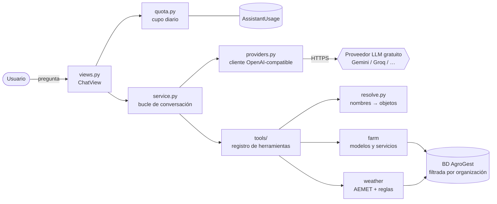
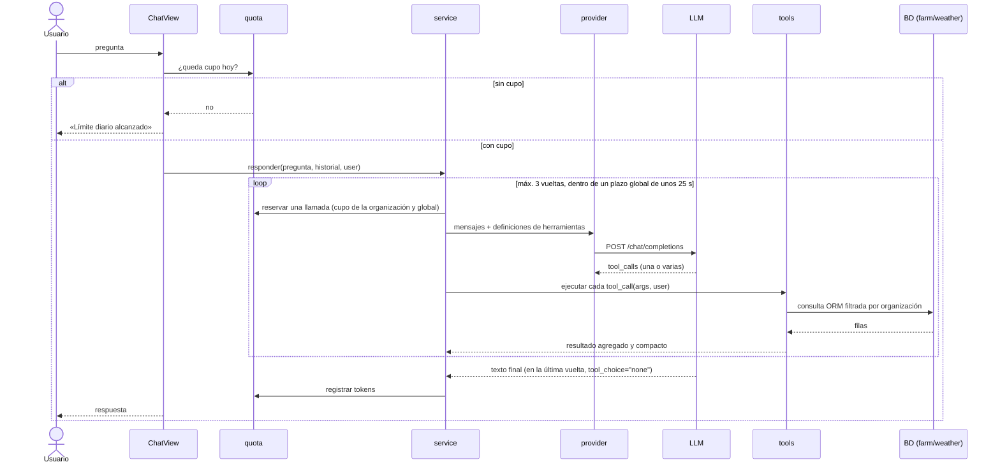
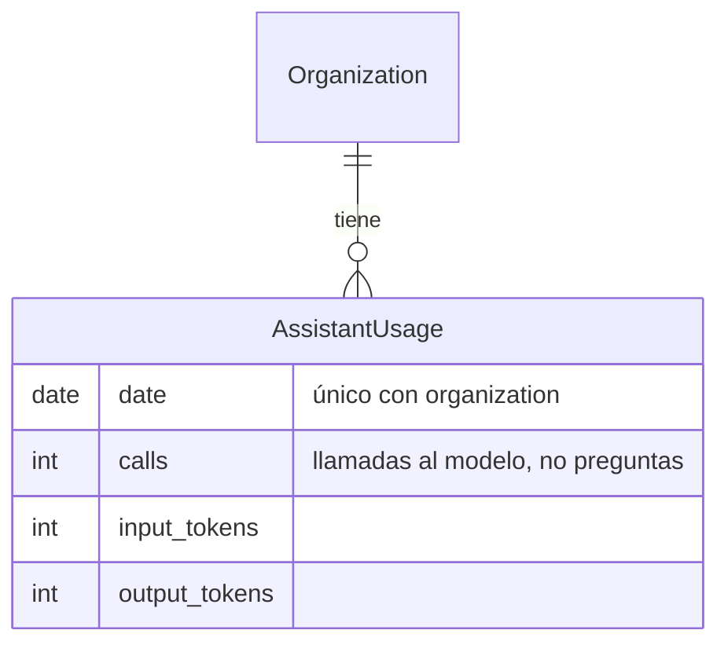
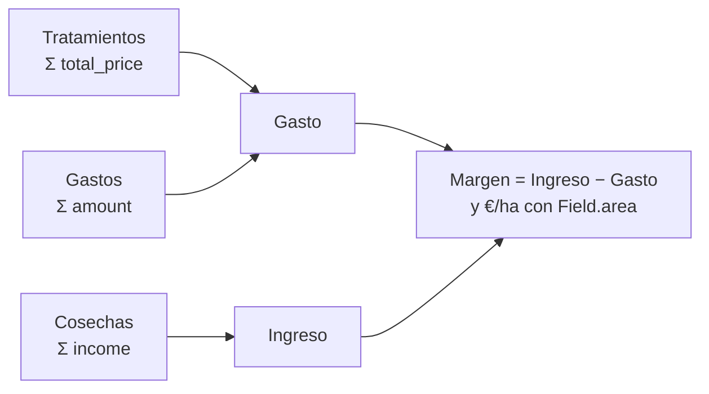
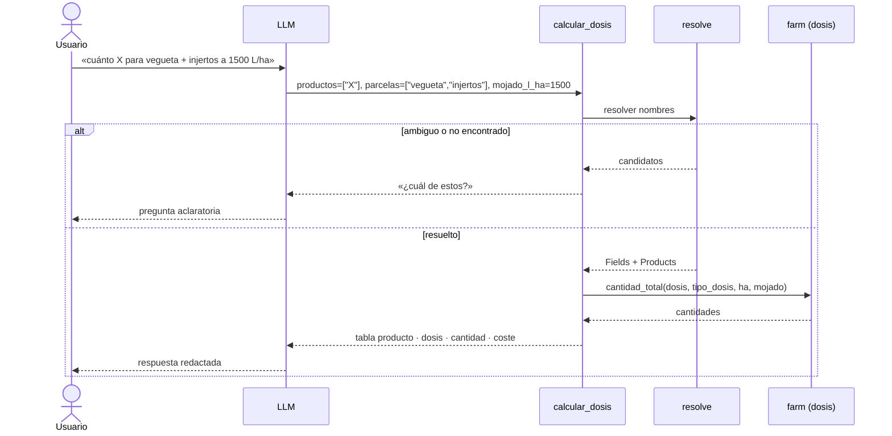

# Asistente IA (`assistant`)

> **Estado:** diseño. Todavía no hay código. Este documento fija la arquitectura, los casos de uso y los límites antes de implementar.

Asistente de **solo lectura** que responde en lenguaje natural sobre los datos de la organización: tratamientos, costes, productos, tiempo y cálculo de compras.

---

## 1. Decisiones clave

| Decisión | Por qué |
|---|---|
| **App propia `assistant`** | Cumple los criterios de cuándo crear una app: depende de un servicio externo con cuotas, se puede quitar sin romper nada y solo depende de `farm`, `weather` y `core`, sin ciclos. Sustituye la decisión anterior de dejarlo en `farm`. |
| **Tool calling** | El modelo pide los datos que necesita mediante funciones nuestras. Se descartan el **volcado de contexto** (es lo que encareció el módulo anterior), **RAG** (sirve para texto libre y aquí los datos son tablas) y **text-to-SQL** (con varias organizaciones, un fallo filtraría datos de otra). |
| **Los cálculos los hace Python, no el modelo** | Las dosis, totales y costes salen del mismo código que usa la app. El modelo solo interpreta la pregunta y redacta la respuesta, así que no se inventa números. |
| **Un único cliente compatible con OpenAI** | Gemini, Groq, OpenRouter y Cloudflare Workers AI aceptan el formato `chat/completions` con herramientas. Cambiar de proveedor es cambiar tres variables de entorno. Se implementa con `urllib`, igual que `weather/aemet/client.py`, así que no añade dependencias. |
| **Solo lectura** | Para crear o editar ya existen los formularios. Así evitamos confirmaciones y acciones peligrosas, y las herramientas son más pequeñas. Se puede ampliar más adelante. |
| **Historial en la sesión de Django, no en BD** | No hay ningún requisito de guardar conversaciones (el antiguo `ChatMessage` se borró). Se guardan solo los últimos 4 turnos. |

---

## 2. Arquitectura

### Componentes



**Dependencias:** `assistant → farm, weather, core`. Ninguna app depende de `assistant`.

### Estructura de carpetas

```
assistant/
  apps.py
  urls.py · views.py      # ChatView (POST pregunta → respuesta), con FeatureFlagMixin
  service.py              # bucle: modelo ↔ herramientas (máx. 3 vueltas)
  providers.py            # cliente HTTP compatible con OpenAI (urllib)
  quota.py                # cupo diario por organización
  prompts.py              # prompt de sistema
  models.py               # AssistantUsage
  tools/
    __init__.py           # registro: nombre → (esquema JSON, función)
    resolve.py            # «vegueta» → Field, «cobre» → Product
    treatments.py · costs.py · products.py · purchase.py · weather.py
  tests/
templates/assistant/chat.html   # convención del proyecto: plantillas globales
```

### Flujo de una pregunta



### Modelo de datos



`calls` cuenta **llamadas al modelo** (hasta 3 por pregunta), porque es lo que cuenta el proveedor. Se incrementa con `get_or_create` + `F()` para que dos peticiones simultáneas no se pisen.

### Detalles del bucle (`service.py`)

- **Plazo global por pregunta** (unos 25 s): el timeout de cada llamada es lo que quede del plazo. Así la suma de llamadas al modelo y AEMET (`SUMMARY_BUDGET` = 12 s) no supera el límite de gunicorn (30 s por defecto).
- **Gunicorn hoy tiene 1 worker síncrono** (`entrypoint.sh` no indica `--workers` ni `--threads`): mientras el asistente espera al proveedor, nadie más puede usar la app. Antes de activarlo hay que subir a `--workers 2 --threads 4` o similar.
- Se ejecutan **todas** las `tool_calls` de cada respuesta, y cada resultado se devuelve con su `tool_call_id`.
- En la última vuelta se envía `tool_choice="none"` para obligar a dar un texto final.
- Si el modelo pide una herramienta que no existe o manda JSON inválido, se le devuelve un error como resultado de la herramienta; no se lanza una excepción.
- **Modelos con razonamiento:** en algunos (por ejemplo, Gemini 2.5) los tokens de razonamiento cuentan dentro de `max_tokens` y la respuesta puede salir vacía. Hay que desactivarlo o bajarlo (`reasoning_effort`) o elegir un modelo sin razonamiento.
- La lista de herramientas se construye **en cada petición**, para respetar los flags (por ejemplo, `WEATHER`) sin reiniciar.

---

## 3. Herramientas

Reglas comunes:

- **La organización nunca la decide el modelo.** Cada función recibe `user` desde la vista y filtra **siempre** por `organization=user.organization`. No se usa `get_queryset_for_user`, porque a un superusuario le devuelve todas las organizaciones y el asistente mezclaría datos. Un usuario sin organización recibe un 403.
- **Se usan nombres en vez de IDs.** El modelo pasa «vegueta» y `resolve.py` lo busca sin distinguir mayúsculas ni tildes. Si hay 0 coincidencias o más de una, la herramienta devuelve los candidatos y el modelo pregunta al usuario. Así no hace falta una herramienta de «listar» ni una vuelta extra.
- **Las parcelas también se eligen por cultivo o variedad, con un parámetro aparte.** `parcelas` son nombres y `cultivo` es la variedad («todas las leanri» → `cultivo=["leanri"]`). Así decide el modelo, que ve la frase, y la herramienta no adivina. Orden de resolución:
  1. Coincidencia exacta, sin mayúsculas ni tildes: con un nombre de parcela devuelve esa parcela; con `cultivo` devuelve **todas** las que lo tienen (el usuario dijo «todas»).
  2. Si no hay coincidencia exacta, se busca por contenido (`icontains`). Si sale más de una, se devuelven candidatos y se pregunta.

  `Field.crop` es texto libre, así que la respuesta siempre lista las parcelas incluidas y su superficie. Una parcela con `area` vacía o 0 se excluye y se avisa.
- **Convención de la máquina:** «a la máquina» o «por máquina» significan siempre **2.000 L**, con independencia de la capacidad registrada en `Machine`. Lo dice el prompt y lo aplica la herramienta: el modelo pasa la unidad `kg_por_maquina` o `l_por_maquina` y el código la convierte (x por máquina = x/2 por 1000 L). Las respuestas que dan cantidades por máquina lo indican («máquina = 2.000 L»). La capacidad real de la máquina solo se usa para contar cargas.
- **Dentro de un parámetro, los valores se combinan con «o»; entre parámetros, con «y».** `parcelas=["vegueta","cartuja"]` + `tipo_producto=["fungicida"]` = fungicidas en la vegueta o en la cartuja. Las combinaciones más raras se resuelven con varias llamadas en la misma vuelta.
- **Los productos se buscan por nombre comercial** (`Product.name`). La materia activa («cobre») no está en el modelo de datos, así que el modelo solo la encontrará si forma parte del nombre. Los productos desactivados (`is_active=False`) entran en el historial; en `calcular_dosis` se avisa de que están desactivados.
- **Fechas en formato ISO.** El prompt incluye la fecha de hoy. Si el usuario no da periodo, el modelo usa el año natural en curso. Las herramientas pasan siempre `desde` y `hasta` explícitos a los métodos de `farm`, que tienen sus propios valores por defecto.
- **Solo cuenta lo aplicado.** Los costes y consumos cuentan los tratamientos `completed`. Los pendientes y atrasados salen en una línea aparte («planificado»), para que «¿cuánto llevamos gastado?» no salga inflado. Hay que tenerlo en cuenta porque `Field.get_treatments_cost` y `get_cost_by_product_type` no filtran por estado.
- **Salida compacta:** texto tabular con solo los campos necesarios, un máximo de 20 filas y «… y N más».

| Herramienta | Parámetros | Reutiliza | Devuelve |
|---|---|---|---|
| `historial_tratamientos` | `parcelas?`, `cultivo?`, `productos?`, `tipo_producto?`, `estado?` (lista: `pendiente` · `atrasado` · `aplicado`), `desde?`, `hasta?`, `modo` (`lista` · `ultimo_por_parcela` · `contar`), `limite=10` (solo en `lista`) | `Treatment`, `TreatmentProduct` | fecha, parcela, nombre, estado y productos con su dosis; o el último por parcela; o el nº de aplicaciones |
| `costes` | `parcelas?`, `desde?`, `hasta?`, `agrupar_por` (`parcela` · `tipo_producto` · `tipo_gasto`), `incluir_ingresos=false` | `TreatmentProduct.total_price` (por `treatment__finish_date`), `Expense.amount` (por `payment_date`), cosechas con `Sum(F("sale_price_per_kg") * F("amount"))` (`Harvest.income()` es un método y no se puede agregar en el ORM) | € totales, €/ha y, con ingresos, el margen y la producción (kg y kg/ha) |
| `consumo_producto` | `nombre`, `desde?`, `hasta?` | `TreatmentProduct`, `ProductPriceHistory` | consumo total, nº de tratamientos, precio actual con su unidad y cambios de precio |
| `calcular_dosis` | `productos[]`, `parcelas?`, `cultivo?`, `mojado_l_ha?`, `tipo` (`pulverizacion` → `spraying` · `fertirrigacion` → `fertigation`), `dosis?: [{producto, valor, unidad}]` (unidades en español: `l_por_1000l`, `kg_por_1000l`, `l_por_ha`, `kg_por_ha`, `porcentaje`, `l_por_maquina`, `kg_por_maquina`; el código las traduce a las de `Product`) | `Product.get_dose(t)` / `get_dose_type(t)`, `Product.price` y la fórmula de dosis de `farm` (ver §4.5) | por producto: dosis, **cantidad por máquina (2.000 L)**, precio por unidad (€/kg o €/L), **coste por ha**; con parcelas, además, cantidad total, coste total, caldo y cargas |
| `compra_pendiente` | `parcelas?`, `cultivo?` | `farm.services.get_shopping_list` (la misma lista que «Preparar productos») | por producto: cantidad para los tratamientos pendientes y atrasados, coste y reparto por casetilla; las parcelas sin casetilla salen como «sin casetilla asignada» |
| `ventana_tratamiento` | `parcelas?`, `dias=3` | `weather.services.get_weather_summary` (cada día ya trae su `level` calculado con `treatment_rules`) | por municipio y día: `ok` / `warn` / `bad`, % de lluvia y viento |

Si el flag `WEATHER` está apagado, `ventana_tratamiento` no se registra y el modelo no la ve.

---

## 4. Casos de uso y cómo se resuelven

### 4.1 Historial de tratamientos

- *«¿Cuándo tratamos por última vez la vegueta?»* → `historial_tratamientos(parcelas=["vegueta"], estado=["aplicado"], modo="ultimo_por_parcela")`, ordenado por `finish_date` descendente (la fecha en que se aplicó realmente)
- *«¿Qué productos hemos echado este mes?»* → `historial_tratamientos(desde="2026-11-01")`
- *«¿Cuándo fue la última vez que tratamos con fungicida vegueta o cartuja?»* → `historial_tratamientos(parcelas=["vegueta","cartuja"], tipo_producto=["fungicida"], estado=["aplicado"], modo="ultimo_por_parcela")`. Devuelve una fila por parcela, así responde a las dos lecturas de la pregunta.
- *«¿Cuántas veces hemos echado Cabrio este año en la cartuja?»* → `historial_tratamientos(parcelas=["cartuja"], productos=["cabrio"], modo="contar")`. Sirve para no pasarse del número máximo de aplicaciones de la etiqueta, aunque ese máximo no está en AgroGest y lo tiene que saber el usuario.
- *«¿Qué tengo pendiente esta semana?» / «¿Qué va atrasado?»* → `historial_tratamientos(estado=["pendiente","atrasado"], hasta="2026-11-08")`.

El modelo traduce la pregunta a filtros y redacta la respuesta con las filas devueltas. Si la parcela no existe o es ambigua, la herramienta devuelve candidatos y el modelo pregunta cuál.

### 4.2 Costes y rentabilidad

- *«¿Cuánto llevamos gastado este año en injertos?»* → `costes(parcelas=["injertos"], desde="2026-01-01")`
- *«¿En qué se nos va el dinero?»* → `costes(agrupar_por="tipo_producto")`
- *«¿Qué parcela es más rentable?»* → `costes(agrupar_por="parcela", incluir_ingresos=true)`
- *«¿Cuántos kilos por hectárea sacamos en la vegueta este año y el pasado?»* → dos llamadas a `costes(parcelas=["vegueta"], incluir_ingresos=true, …)` en la misma vuelta, una por año Los kg/ha se calculan como Σ kg de las cosechas / Σ superficie de las parcelas, contando cada parcela una vez. No se suman los `kg_per_ha` de cada cosecha, porque eso cuenta mal cuando hay varias cosechas en la misma parcela.



**Caso límite:** las cosechas sin precio de venta no tienen ingreso. Se cuentan aparte («2 cosechas sin precio») para que el modelo lo diga y no dé un margen engañoso.

### 4.3 Productos y compras

- *«¿Cuánto cobre hemos gastado esta campaña?»* → `consumo_producto(nombre="cobre", desde=…)`
- *«¿Ha subido el precio del X?»* → `consumo_producto(nombre="X")` (usa `ProductPriceHistory`)

### 4.4 Tiempo y ventana de tratamiento

- *«¿Puedo tratar mañana la vegueta?»* → `ventana_tratamiento(parcelas=["vegueta"], dias=2)`

Los umbrales **no los decide el modelo**: son los de `weather/treatment_rules.py`, los mismos que muestra la pantalla de Tiempo. `ok` es lluvia < 20 % y viento ≤ 20 km/h; `bad` es lluvia ≥ 50 % o viento > 25 km/h; `warn` es lo que queda entre ambos. La caché y los errores de AEMET los gestiona `get_weather_summary`; la herramienta devuelve sus `errors` (parcela sin ubicación, AEMET caído) para que el modelo los explique.

### 4.5 Cálculo de dosis y compra para un tratamiento

Es el caso más usado y el que más variantes tiene. Todas acaban en la misma llamada a `calcular_dosis`:

| Frase | Parámetros |
|---|---|
| «Dime cuánto X tengo que comprar para tratar vegueta + injertos a 1500 L/ha» | `productos=["X"]`, `parcelas=["vegueta","injertos"]`, `mojado_l_ha=1500` |
| «Voy a tratar con X + Y todas las leanri, ¿cuánto producto me hace falta?» | `productos=["X","Y"]`, `cultivo=["leanri"]`. Si las dosis de X o Y dependen del caldo, falta el mojado y se pregunta. |
| «… a la dosis normal y a 2 kg/máquina» | dos llamadas en la misma vuelta: una sin `dosis` y otra con `dosis=[{producto:"X", valor:2, unidad:"kg_por_maquina"}]` |
| «… X a 300 cc por máquina e Y a la normal» | `dosis=[{producto:"X", valor:0.3, unidad:"l_por_maquina"}]`. El modelo convierte cc a L; Y usa su dosis de AgroGest. |
| «… mojando 1200 en vez de 1500» | otra llamada con `mojado_l_ha=1200` |
| «Para fertirrigar la cartuja con X» | `tipo="fertirrigacion"`: dosis por hectárea, sin mojado |



**Cálculo** (dosis estándar del producto para el tipo de aplicación: `Product.get_dose(t)` / `get_dose_type(t)`):

| Tipo de dosis | Cantidad total |
|---|---|
| L/1000L, kg/1000L | dosis × mojado × ha / 1000 |
| % | dosis / 100 × mojado × ha |
| L/ha, kg/ha | dosis × ha (el mojado no influye) |

| kg o L **por máquina** (solo en `dosis`) | se convierte a kg o L/1000L dividiendo entre 2 (máquina = 2.000 L) y sigue como arriba |

**Cantidad por máquina (2.000 L):**

| Tipo de dosis | Por máquina |
|---|---|
| L/1000L, kg/1000L | dosis × 2 |
| % | dosis / 100 × 2.000 |
| L/ha, kg/ha | dosis × 2.000 / mojado (necesita mojado) |

La unidad sigue la regla de `TreatmentProduct.set_dose_units`: kg para `kg_per_*` y L para el resto (incluido `%`). En **fertirrigación** solo existen dosis por hectárea, así que no se pide mojado ni se habla de máquina.

**Cargas:** se calculan con la capacidad real de la máquina de pulverización, con la misma regla que `Treatment.calculate_machine_loads` (cargas completas = caldo ÷ capacidad; hay carga parcial si sobran más de 50 L). Ese método pertenece a `Treatment` y aquí no hay tratamiento, así que la regla se extrae a `farm/dosing.py`. Si la organización tiene una sola, se usa esa; si tiene varias, se omiten las cargas y se dice en la respuesta. Las dosis «por máquina» siempre son por 2.000 L, como en el resto de la convención.

*Ejemplo:* vegueta 2 ha + injertos 1,5 ha = 3,5 ha → 5.250 L de caldo. Con X a 0,5 L/1000L salen 2,6250 L. La herramienta devuelve 4 decimales, igual que la app (`total_dose`), y el coste es `_round(cantidad × Product.price, 2)`. Al redondear a 2 decimales con «mitad al par», como hace `_round`, quedarían 2,62 L.

**Casos límite:**

- **No resta existencias:** AgroGest no lleva inventario, así que «comprar» significa «cantidad necesaria». La respuesta lo indica.
- **Producto sin dosis para ese tipo de aplicación:** se informa y el modelo pide la dosis y su tipo, que se pasan en `dosis`.
- **Falta el mojado y la dosis depende del caldo:** la herramienta lo pide. No se asume `REFERENCE_WATER_PER_HA` (1000 L/ha) porque cambiaría la cantidad a comprar sin que el usuario lo sepa. Con dosis por hectárea no hace falta.
- **No se redondea a envases**, porque no tenemos el formato de venta.

**Prerrequisito:** se extraen dos funciones puras a `farm/dosing.py`, para que el asistente dé **exactamente** las mismas cifras que la app:

- `amount_per_ha(dose, dose_type, water_per_ha)`: total por superficie. Hoy está repetida en `TreatmentProduct.calculate_total_dose` y `Product.cost_per_ha`.
- `amount_for_water(dose, dose_type, water_l, water_per_ha)`: cantidad para un volumen de caldo dado. Sirve para la máquina de 2.000 L, para la capacidad real y para la carga parcial. Hoy está repetida en `get_dose_per_load` y `calculate_product_for_partial_load`. Esos métodos devuelven `float` (o `0`/`None`); ese tipo se mantiene en ellos para no romper plantillas ni tests, y la función nueva devuelve `Decimal`.
- `machine_loads(total_water, capacity)`: regla de cargas, sacada de `Treatment.calculate_machine_loads`.

### 4.6 Ficha rápida de un producto

> *«¿Cuánto va a la máquina el Cabrio, cuánto cuesta el litro y cuánto me va a costar por ha mojando 1500 L/ha?»*

→ `calcular_dosis(productos=["cabrio"], mojado_l_ha=1500)`, **sin parcelas**. Devuelve:

| Dato | De dónde sale |
|---|---|
| Por máquina | dosis normal de AgroGest convertida a 2.000 L (tabla de §4.5) |
| Precio | `Product.price` **con su unidad real**. Si el producto va en kg (`kg_per_*`), la respuesta dice «se vende por kg: X €/kg», aunque el usuario preguntara por el litro. |
| Coste por ha | `Product.cost_per_ha(t, mojado)`, el mismo método que usa la app. Se llama **siempre con el mojado del usuario**: sin él, el método usaría 1.000 L/ha sin avisar. Si falta y la dosis depende del caldo, se pide. |

Variantes:

- *«¿Qué sale más barato por ha, X o Y?»* → `calcular_dosis(productos=["X","Y"], mojado_l_ha=…)`. Se compara el coste por ha.
- *«¿Cuánto me cuesta el Cabrio a 2 kg por máquina?»* → con `dosis`, para ver el coste a otra dosis.

Si el producto no tiene precio, la herramienta lo dice y no inventa un coste.

### 4.7 Lo que hay pendiente

- *«¿Qué tengo que comprar para lo que queda pendiente?»* → `compra_pendiente()`
- *«¿Cuánto llevo a cada casetilla?»* → `compra_pendiente()`, con el reparto por casetilla que ya calcula `get_shopping_list`.

Reutiliza la misma función que la pantalla «Preparar productos», así que las cifras coinciden. `get_shopping_list` filtra con `get_queryset_for_user`, que a un superusuario le devuelve todo: como la función solo recibe `user`, el prerrequisito es añadirle un parámetro `organization` que tenga prioridad sobre el usuario (ver §3, reglas comunes). La herramienta resuelve las parcelas a IDs para pasarlas en `field_ids`.

### 4.8 Fuera de alcance

Si ninguna herramienta cubre la pregunta, el prompt obliga a decir que no puede responderla, en vez de inventar. Ejemplos:

- **Datos que AgroGest no tiene:** plazo de seguridad, materia activa, número máximo de aplicaciones de la etiqueta, existencias en la casetilla.
- **Consejos agronómicos:** «¿qué echo contra el mildiu?».
- **Escribir:** «crea un tratamiento», «cambia la dosis».

Las preguntas que acaban así se registran (solo el texto, sin datos de la organización) para decidir qué herramienta añadir según el uso real.

---

## 5. Ahorro de tokens

| Técnica | Efecto |
|---|---|
| Tool calling | Solo viajan los datos pedidos, nunca la organización entera. |
| 6 herramientas (5 con `WEATHER` apagado) con descripciones cortas | Las definiciones se envían en **cada** llamada; menos herramientas son menos tokens fijos. |
| Resolución de nombres en el servidor | Ahorra una vuelta de «listar parcelas/productos». |
| Resultados agregados en texto tabular | Mucho más corto que JSON con claves repetidas. Máximo 20 filas. |
| Historial de 4 turnos, sin resultados de herramientas antiguos | El coste no crece con la conversación. Para que no se pierdan las aclaraciones («¿cuál de estas parcelas?» → «la segunda»), el prompt obliga a escribir los candidatos en el texto de la respuesta, que sí se conserva. |
| `max_tokens` = 500 y máximo 3 vueltas | Acota el peor caso. |
| Prompt de sistema < 300 palabras | Coste fijo bajo. |

Estimación orientativa: **2.000–6.000 tokens por pregunta**, porque en cada vuelta se reenvían el prompt, las herramientas y el historial. En los planes gratuitos suele limitar antes el número de peticiones que el de tokens. No hacen falta formatos de serialización especiales: los datos son pocos (unas 6 parcelas) y lo que encarece es enviar de más, no el formato.

---

## 6. Garantía de coste cero

1. **Clave de un proyecto sin facturación.** Si no hay tarjeta asociada, el proveedor no puede cobrar: al agotar la cuota responde `429`. Esta es la garantía real.
2. **Cupo propio** (`AssistantUsage`), comprobado **antes de cada llamada** al modelo, no solo al empezar la pregunta:
   - `ASSISTANT_DAILY_LIMIT`: llamadas por organización y día.
   - `ASSISTANT_GLOBAL_DAILY_LIMIT`: total de la instancia, porque la clave es única y la comparten todas las organizaciones. Va con margen por debajo del límite gratuito.
3. **Feature flag `ASSISTANT` creado apagado** con una migración de datos. `core.models.is_enabled` devuelve `True` si el flag no existe, así que sin esa migración el módulo aparecería encendido. Además, la vista y el menú comprueban que exista `ASSISTANT_API_KEY`, porque `FeatureFlagMixin` no lo hace.
4. **Sin reintentos automáticos** ante `429` o timeout, porque reintentar gasta cupo. El usuario ve «El asistente ha llegado al límite de hoy». El `429` también puede venir del límite por minuto del proveedor; el mensaje distingue «inténtalo en un minuto».
5. **Plazo global por pregunta** (unos 25 s), por debajo del timeout de gunicorn (ver §2).

Variables de entorno: `ASSISTANT_API_KEY`, `ASSISTANT_BASE_URL`, `ASSISTANT_MODEL`, `ASSISTANT_DAILY_LIMIT`, `ASSISTANT_GLOBAL_DAILY_LIMIT`.

**Proveedor inicial:** Gemini (Google AI Studio) a través de su endpoint compatible con OpenAI. Las alternativas con el mismo cliente son Groq y los modelos `:free` de OpenRouter. En Cloudflare Workers AI no todos los modelos admiten herramientas. Los límites gratuitos cambian a menudo: hay que revisarlos en la documentación oficial al implementar, igual que el soporte de herramientas del modelo elegido.

**Aviso:** en el plan gratuito de Gemini, Google puede usar los datos enviados para mejorar sus productos. Con uso familiar es aceptable; si entran usuarios externos, hay que avisarlo en la pantalla del chat o pasar a Groq por defecto.

---

## 7. Seguridad

- Organización tomada de `request.user`; las herramientas no aceptan IDs de organización.
- Solo lectura: no existe ninguna herramienta que escriba.
- Respuesta mostrada como texto escapado: sin `|safe` ni librerías de Markdown que generen HTML, como mucho `linebreaksbr`.
- *Prompt injection*: un nombre o comentario podría contener instrucciones. El impacto está acotado (solo lectura y dentro de la propia organización), y además no se envían campos de texto libre innecesarios, como `comments`.
- Pregunta limitada a 500 caracteres.

---

## 8. Pruebas

- **Herramientas:** tests unitarios aislados con `factory-boy`, sin red.
- **Servicio:** proveedor falso que devuelve `tool_calls` preparados (prueba el bucle y el límite de vueltas).
- **Cupo:** límite por organización, límite global y conteo por llamada.
- **Aislamiento:** cada herramienta y `resolve.py` con dos organizaciones, con un superusuario y con un usuario sin organización.
- **Plazo global:** un proveedor falso lento corta la pregunta a tiempo.
- Los tests **nunca** llaman a la API real.

---

## 9. Orden de implementación

1. Extraer la fórmula de dosis en `farm` y añadir sus tests (§4.5).
2. App `assistant`: proveedor, servicio, cupo y flag apagado por migración, probados con el proveedor falso.
3. Herramientas una a una, empezando por `calcular_dosis` e `historial_tratamientos`.
4. Vista y plantilla.
5. Subir los workers y threads de gunicorn.
6. Pasar el conjunto de prueba (§10).
7. Activar con el flag en producción.

---

## 10. Conjunto de prueba

Las frases de §4, con sus parámetros esperados, forman el conjunto de prueba del modelo. Comprueba que el modelo traduce bien el lenguaje libre: «a la máquina», «cc», «todas las leanri», preguntas con «o», unidades mal dichas.

- Se ejecuta **a mano** contra el modelo real (por ejemplo, `manage.py assistant_eval`), nunca en CI, para no gastar cupo.
- Compara las llamadas a herramientas y sus parámetros, no el texto de la respuesta.
- Cada pregunta real que falle se añade al conjunto.
